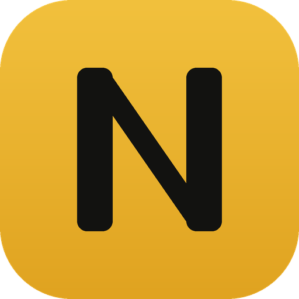
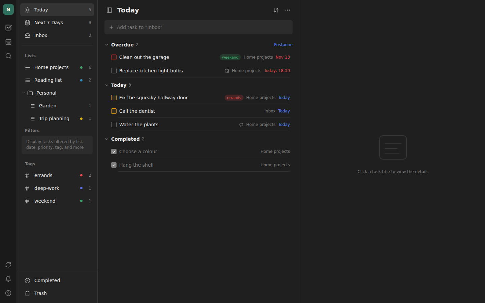
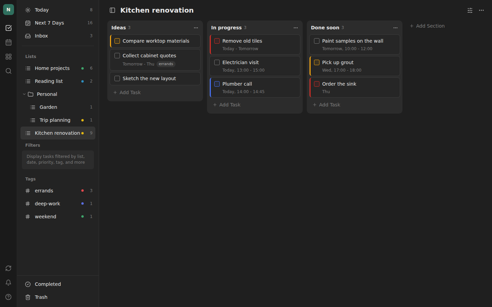
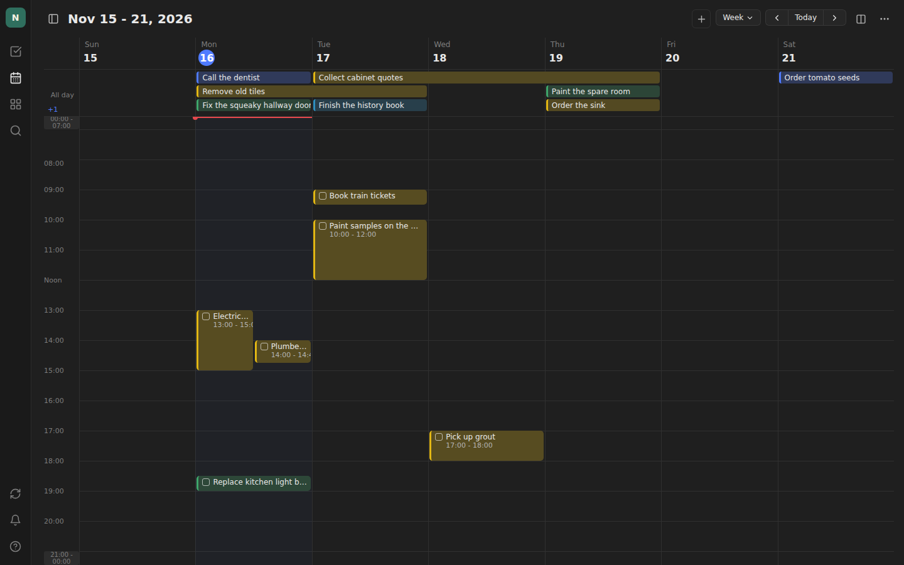
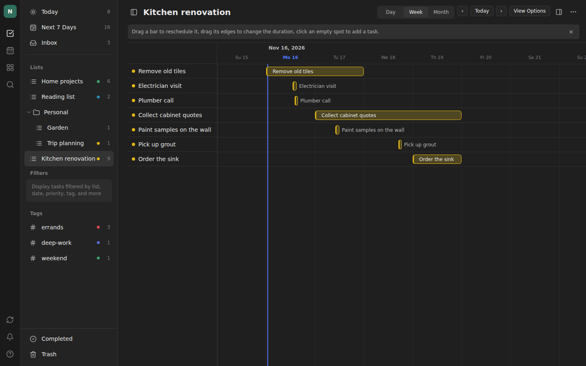
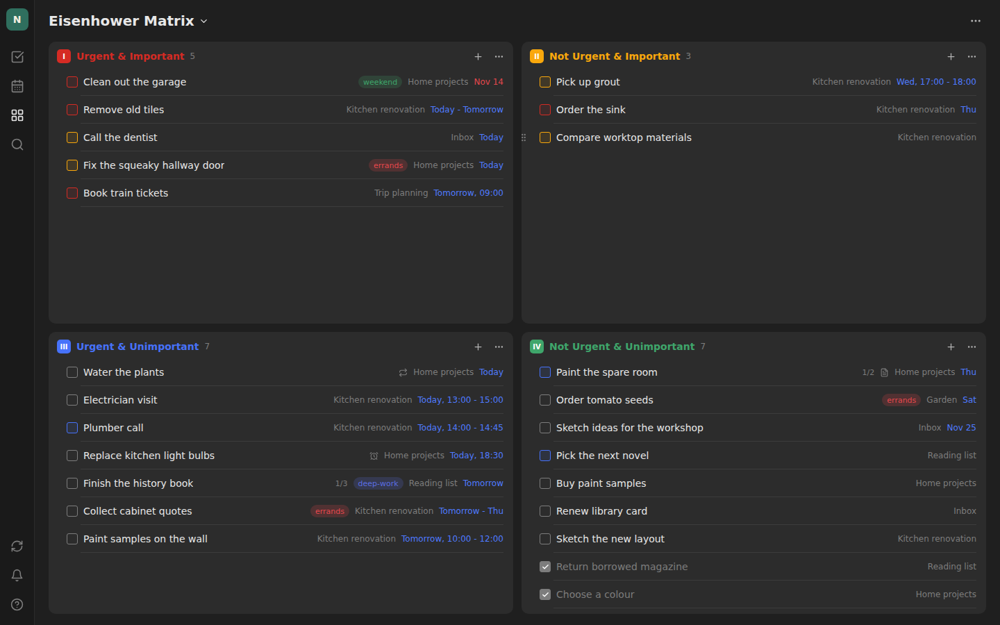
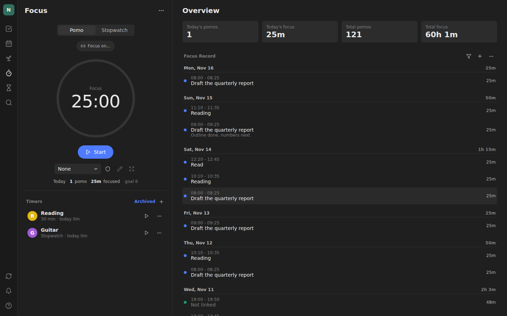
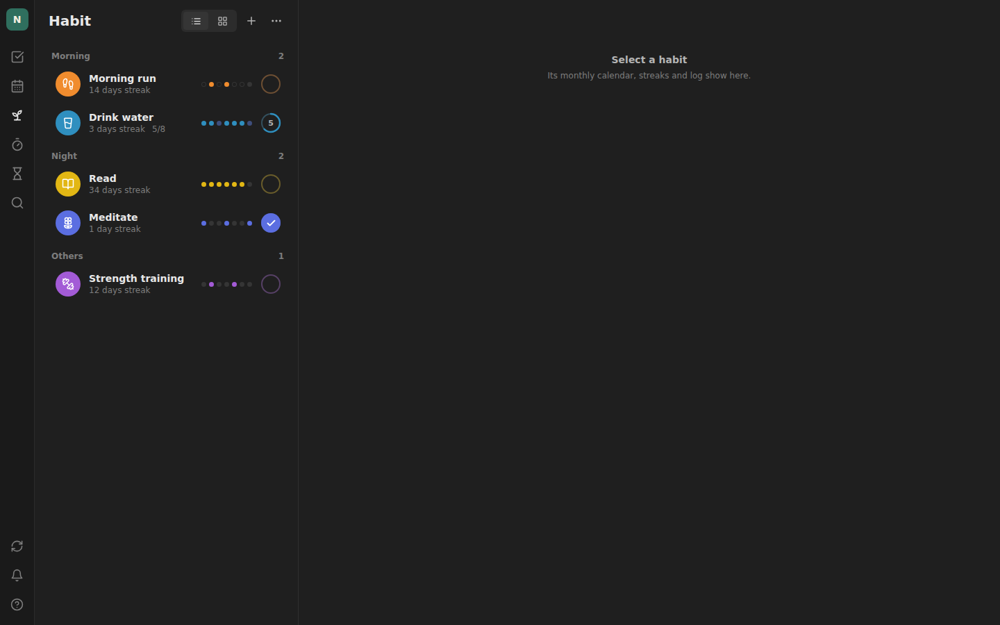
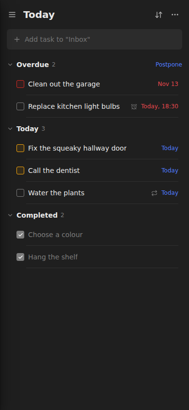

<div align="center">



# NoorTasks

**A self-hosted, local-first personal task manager, calendar, habit tracker, and focus timer.**

[](LICENSE)
[](.github/workflows/ci.yml)
[](docker-compose.yml)
[](https://ko-fi.com/trevorj_ai)

[Quick Start](#one-command-install) · [Deploy](#deploy) · [Features](#features) · [Screenshots](#screenshots) · [Documentation](docs/install.md) · [Roadmap](#roadmap)

</div>

---

NoorTasks stores your tasks, notes, habits, focus sessions, and attachments on hardware you control, backed by a single SQLite file and an offline-first browser database (`IndexedDB`). Everything is unlocked under the MIT license with no paid tiers, telemetry, or external account lock-in.

## Screenshots

| Today & Smart Lists | Kanban Board |
| :---: | :---: |
|  |  |

| Week Calendar | Timeline View |
| :---: | :---: |
|  |  |

| Eisenhower Matrix | Focus Timer & Records |
| :---: | :---: |
|  |  |

| Habit Tracker | Mobile Layout |
| :---: | :---: |
|  |  |

## Features

- **Local-first & offline-capable PWA**: React + Vite client backed by Dexie (`IndexedDB`) queues changes locally when offline and syncs incrementally over HTTP checkpoints.
- **Task organization**: Inbox, Today, Tomorrow, Next 7 Days, All, Completed, Won't Do, Trash, folders, lists, nested subtasks, inline checklists, tags, priority levels, and custom rule-based smart filters.
- **Multiple planning views**: List view with customizable grouping/sorting, Kanban sections, drag-and-drop Timeline, 4-quadrant Eisenhower Matrix, and 7 calendar layouts (Day, Multi-day, Week, Multi-week, Month, Agenda, Year).
- **Natural-language quick add & recurrence**: Inline parsing for dates, times, date ranges, tags, priorities, reminders, and recurring rules (including completion-date repeats and skip dates).
- **Calendar feeds & sync**: Private outgoing ICS feeds, incoming ICS subscriptions with conditional caching, built-in holiday presets, two-way Google and Outlook OAuth calendar bindings, and read-only CalDAV / iCloud calendars.
- **Habits, focus & countdowns**: Habit streaks, daily check-ins, and mood logs; Pomodoro and stopwatch timer with Web Audio ambient sounds; productivity statistics, daily/weekly summaries, and date countdowns.
- **Attachments, comments & templates**: Disk-backed file attachments with in-app preview, task comments, reusable task and project templates, and activity logs.
- **Reminders**: Web Push (VAPID) notifications in browsers and native `AlarmManager` notifications on Android.
- **Portable backups & import**: 23-column CSV task backup/restore, CSV/XLSX exports for habits and focus logs, and Markdown single-task exports. See the [Backup & Import guide](docs/import.md).
- **Zero external runtime database**: Runs on Node 22 (`node:sqlite` in WAL mode) plus Fastify. No separate PostgreSQL or Redis container needed.

## One-Command Install

Start NoorTasks with Docker Compose in one directory using a named persistent volume:

```bash
curl -O https://raw.githubusercontent.com/TrevorJ-AI/noortasks/main/docker-compose.yml
NOORTASKS_PASSPHRASE="change-this-passphrase" docker compose up -d
```

Or launch directly with `docker run`:

```bash
docker run -d \
  --name noortasks \
  --restart unless-stopped \
  -p 8099:8099 \
  -e NOORTASKS_PASSPHRASE="change-this-passphrase" \
  -v noortasks_data:/data \
  ghcr.io/TrevorJ-AI/noortasks:latest
```

Then open `http://localhost:8099` and sign in with the passphrase you chose (minimum 8 characters). On first start, the container hashes the passphrase into `/data/config.json` with `scrypt` (`0600` permissions). After initial creation, you can remove `NOORTASKS_PASSPHRASE` from your environment.

For reverse-proxy TLS, Web Push keys, calendar OAuth setup, and bare-Node installs, see [docs/install.md](docs/install.md) and [docs/configuration.md](docs/configuration.md).

## Deploy

Step-by-step hosting guides (each ending at the one-time browser setup page and phone QR pairing):

- [Windows and Linux desktop hub](docs/desktop.md) (runs the server on your computer, with a tray menu and optional Tailscale HTTPS)
- [Deploy on Railway](docs/hosting/railway.md) (uses [`.railway/railway.ts`](.railway/railway.ts))
- [Deploy on Coolify](docs/hosting/coolify.md) (uses [`docs/hosting/coolify.compose.yml`](docs/hosting/coolify.compose.yml))
- [Deploy on Fly.io](docs/hosting/fly.md) (uses [`docs/hosting/fly.toml`](docs/hosting/fly.toml))
- [Deploy on a Plain VPS with Caddy](docs/hosting/vps-caddy.md) (uses [`docs/hosting/Caddyfile`](docs/hosting/Caddyfile))

## Android APK & iPhone Notes

- **Android (`apps/android`)**: Pre-built debug APKs are attached to [GitHub Releases](https://github.com/TrevorJ-AI/noortasks/releases). The Capacitor Android app adds offline `AlarmManager` reminder alarms (with **Done** and **Snooze** actions), a **Today** home-screen widget, Android Share Sheet quick capture, a launcher shortcut, and a Quick Settings tile. See [docs/android.md](docs/android.md).
- **iPhone & iPad**: NoorTasks runs as an installable Progressive Web App via Safari's **Share -> Add to Home Screen** menu, including Home Screen Web Push notifications over HTTPS on iOS 16.4+. See [docs/iphone.md](docs/iphone.md).

## How NoorTasks Compares

| Capability | NoorTasks | Hosted Proprietary Task Apps | Plain Markdown / Basic To-Do | Team Issue Trackers |
|---|---|---|---|---|
| Self-hosted & local SQLite | Yes | No | Files only | Usually heavier stack |
| Offline-first client (`IndexedDB`) | Yes | Varies | Local files only | Usually online-only |
| Calendar, Kanban, Timeline & Matrix | Built-in | Often paywalled | Rare | Kanban/Timeline only |
| Habits, Focus timer & Countdowns | Built-in | Often paywalled | No | No |
| Standard CSV backup & export | Yes | Varies | Plain text | Partial |
| Single-user simplicity | Yes (zero extra DB services) | Managed SaaS | Yes | Multi-tenant overhead |
| Multi-user collaboration | Planned | Yes | Manual sync | Yes |
| License | MIT | Proprietary | Varies | Varies |

## Documentation

- [Installation (Docker & Bare Node)](docs/install.md)
- [Hosting Guides (Railway, Coolify, Fly.io, VPS + Caddy)](docs/hosting/vps-caddy.md)
- [Configuration & Environment Variables](docs/configuration.md)
- [Backup & Restore](docs/backup.md)
- [Importing Existing Backups](docs/import.md)
- [Android App Guide](docs/android.md)
- [iPhone & iPad Home-Screen PWA Guide](docs/iphone.md)
- [Multi-User & Sharing Status](docs/multi-user.md)
- [Upgrading](docs/upgrading.md)

## Roadmap & Current Limits

NoorTasks `0.1.0` is built for **personal, single-user self-hosting**. Current known boundaries:

- **Single-user authentication**: One passphrase controls one SQLite database (`docs/multi-user.md`).
- **Multi-user & list sharing**: Planned for a later milestone; sharing endpoints currently return empty lists.
- **Additional CSV importers**: Only the 23-column task backup CSV format is imported natively today; other formats can be converted to that header layout.
- **No hosted sync service**: You host the Node/Docker server yourself (over LAN, reverse-proxied HTTPS, or a private VPN such as Tailscale).

## Support

If NoorTasks saves you time or subscription fees and you want to support ongoing development:

- [](https://ko-fi.com/trevorj_ai) ([https://ko-fi.com/trevorj_ai](https://ko-fi.com/trevorj_ai))

## Provenance & AI-Assisted Development

NoorTasks is an independent open-source project built from public standards and our own tests, with AI coding assistance reviewed and maintained by the author.

## License

Released under the [MIT License](LICENSE) (c) 2026 Trevor J and NoorTasks contributors.
